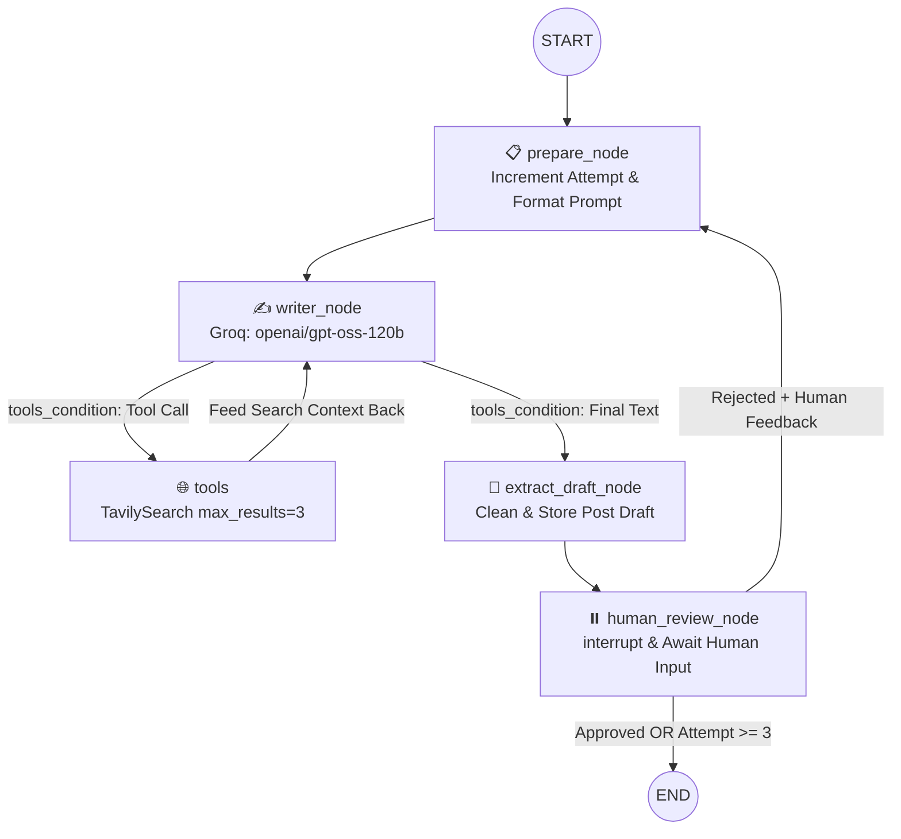

# ⚡ Agentic LinkedIn Post Studio (LangGraph + HITL)


An autonomous, stateful **Agentic AI LinkedIn Content Engine** built with **LangGraph**. It researches real-time web trends using **Tavily Search**, drafts high-converting LinkedIn posts using **Groq (`openai/gpt-oss-120b`)**, and iteratively refines content through both **Human-in-the-Loop (`interrupt` & `Command`)** and **Autonomous AI Reviewer (`Mistral AI`)** workflows.

Wrapped in a custom **Tailwind-inspired dark glassmorphic Streamlit UI** featuring live node-by-node execution telemetry and a realistic LinkedIn feed preview card.

---

## ✨ Key Highlights

* **🌐 Live Web Research Grounding:** Integrates `TavilySearch` via LangGraph `ToolNode` so the Writer Agent automatically pulls up-to-date facts, stats, and industry trends before drafting.
* **⏸️ True Human-in-the-Loop (HITL) Execution:** Uses `langgraph.types.interrupt`, `Command(resume=...)`, and `MemorySaver` checkpointers to pause graph execution mid-flight, wait for human approval or critique, and resume seamlessly from the exact checkpoint.
* **🤖 Dual Workflow Modes:**
  * **HITL Edition (`HITL.py`):** Pauses at `human_review_node` so **you** can approve the post or provide custom rewrite instructions (up to 3 iterations).
  * **Autonomous AI Reviewer Edition (`app.py`):** Uses a strict `ChatMistralAI` (`codestral-2508`) reviewer node that enforces 7 quality criteria automatically.
* **🎨 Custom SaaS Frontend:** Built with Streamlit + custom CSS (`Plus Jakarta Sans` & `JetBrains Mono`), featuring real-time agent telemetry cards, quick-topic chips, live word/iteration metrics, and 1-click clipboard copy.

---

## 🏗️ LangGraph Architecture

### 1. Human-in-the-Loop (HITL) Graph Flow



### 2. Post Quality Guardrails Enforced
Every generated post is evaluated against strict LinkedIn engagement rules:
1. **Strong Hook:** Curiosity-driven first line.
2. **Single Clear Takeaway:** Actionable and focused message.
3. **Skimmable Formatting:** Short, punchy paragraphs.
4. **Optimal Length:** ~150–200 words.
5. **High-Engagement CTA:** Ends with a thought-provoking question.
6. **Human Tone:** Conversational, authentic, and non-robotic.
7. **Zero Hashtags:** Clean, modern LinkedIn formatting.

---

## 🛠️ Tech Stack

| Layer | Technology | Purpose |
| :--- | :--- | :--- |
| **Orchestration** | `LangGraph` | Stateful graph routing, conditional edges, `ToolNode`, `interrupt()`, `Command` |
| **Checkpointer** | `MemorySaver` | Persisting thread state across HITL pauses and Streamlit reruns |
| **Writer LLM** | `ChatGroq` (`openai/gpt-oss-120b`) | Tool-calling, synthesizing search context, and drafting posts |
| **Reviewer LLM** | `ChatMistralAI` (`codestral-2508`) | Strict automated quality gate (Autonomous mode) |
| **Web Search Tool** | `TavilySearch` (`langchain-tavily`) | Fetching top 3 real-time web results for current topics |
| **Frontend UI** | `Streamlit` + Custom CSS/JS | Glassmorphic dashboard, live telemetry stream, LinkedIn card mockup |

---

## 📂 Project Structure

```bash
📦 agentic-linkedin-studio
 ┣ 📜 HITL.py              # Human-in-the-Loop (HITL) LangGraph + Streamlit Studio
 ┣ 📜 app.py               # Autonomous Writer + Mistral Reviewer LangGraph Studio
 ┣ 📜 requirements.txt     # Python dependencies for local & cloud deployment
 ┣ 📜 .env.example         # Template for required API keys
 ┣ 📜 .gitignore           # Excludes .env, venv, and cache files
 ┗ 📜 README.md            # Project documentation
```

---

## 🚀 Local Setup & Installation

### 1. Clone the Repository
```bash
git clone [https://github.com/YOUR_USERNAME/YOUR_REPO_NAME.git](https://github.com/YOUR_USERNAME/YOUR_REPO_NAME.git)
cd YOUR_REPO_NAME
```

### 2. Create & Activate a Virtual Environment
```bash
# macOS / Linux
python3 -m venv venv
source venv/bin/activate

# Windows
python -m venv venv
venv\Scripts\activate
```

### 3. Install Dependencies
```bash
pip install -r requirements.txt
```

### 4. Configure Environment Variables
Create a `.env` file in the root directory and add your API keys:
```env
GROQ_API_KEY="gsk_your_groq_api_key_here"
TAVILY_API_KEY="tvly-your_tavily_api_key_here"
MISTRAL_API_KEY="your_mistral_api_key_here"
```

### 5. Run the Application
To launch the **Human-in-the-Loop (HITL)** Streamlit Studio:
```bash
streamlit run HITL.py
```

To launch the **Autonomous AI Reviewer** Streamlit Studio:
```bash
streamlit run app.py
```

---

## ☁️ Deploying on Streamlit Community Cloud

1. Push your code to a public or private GitHub repository (make sure `.env` is in `.gitignore`).
2. Log in to [Streamlit Community Cloud](https://share.streamlit.io/) and click **Create app**.
3. Select your repository, branch (`main`), and main file path (`HITL.py` or `app.py`).
4. Open **Advanced settings -> Secrets** and paste your keys in TOML format:
   ```toml
   GROQ_API_KEY = "gsk_your_groq_api_key_here"
   TAVILY_API_KEY = "tvly-your_tavily_api_key_here"
   MISTRAL_API_KEY = "your_mistral_api_key_here"
   ```
5. Click **Deploy!**

---

## 👨‍💻 Author

**Abhinav Abhay**  
*B.Tech in Computer Science & Engineering*

---
*If you found this project helpful or inspiring, consider giving the repository a ⭐!*


